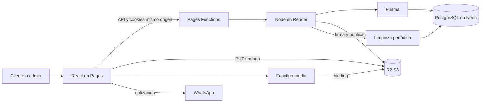

# 01. Arquitectura actual

Fecha: 2026-10-21. Base: 1d6f4be. Rama: qa/auditoria-arquitectura-inventario. Solo auditoría, sin implementar inventario.

## Alcance

Código, contratos, esquema/migraciones SQL, scripts, configuración versionada y pruebas. Git inicialmente limpio y main coincide con el remoto consultado. Sin acceso a paneles ni producción. No se leyeron .env reales, node_modules, dist, .git, lockfile, imágenes o Base64. Sin Docker, integración, migraciones, seed o despliegues. Se usan nombres de variables, nunca valores.

## Componentes

| Capa | Implementación |
| --- | --- |
| UI | React 18.3, TypeScript, Vite 6.4, Tailwind 3, React Router 7, Framer Motion 11, fuentes locales |
| Módulos | src/app rutas/scroll/guards; src/features funcionalidades; src/shared UI/utilidades; shared Zod/taxonomía/contratos |
| Estado | Hooks/contexto de sesión; localStore/useSyncExternalStore para carrito; filtros URL y deduplicación de solicitudes |
| API | node:http, sin Express; createApi concentra routing, validación y acceso |
| Datos | Prisma 5.22/PostgreSQL; consultas parametrizadas y transacciones |
| Archivos | SDK S3 compatible, Pages Function /media con binding PRODUCT_IMAGES |
| Herramientas | Node 24, pnpm 11.21.0, ESLint, tsc, node:test; CI GitHub Actions |
| Externos | WhatsApp, Google Maps opcional; suscripción local sin envío de correo |

Evidencias: package.json:6-69; src/app/App.tsx; server/index.ts:13-32; server/http/app.ts:39-44. El servidor importa tipos desde src/types (repositories/products.ts:4), no es un paquete totalmente independiente. No se necesita microservicios para este alcance.

## Arquitectura

S3_PUBLIC_BASE_URL también permite servir imágenes por URL pública directa. El diagrama representa capacidades, no confirma bindings efectivos del despliegue.

## Sesiones y acceso

Scrypt, token aleatorio con digest HMAC persistido; una sesión por usuario por unique userId. Rotación en login, expiración por inactividad de 4 h para administradores y 30 min para clientes, tope absoluto 8 h. La actividad administrativa se registra con una solicitud autenticada y CSRF protegida, iniciada por interacción; las lecturas no renuevan. CAS limita la persistencia a una vez por minuto. Logout/desactivación revocan. Cookie HttpOnly, Path=/, Secure y prefijo __Host- en HTTPS, SameSite configurable y sin Domain. Roles CUSTOMER/ADMIN. Origin y X-Requested-With exigidos en escrituras; admin obligatorio para productos/media/usuarios. Transacción con advisory lock protege último admin y actor en gestión de cuentas. Limitador compartido en BD con HMAC de dirección. No se encontró cambio propio de contraseña en rutas inspeccionadas.

Fuentes: server/repositories/auth.ts:13-58, users.ts:17-57, http/app.ts:45-47,95-137,218-235. TRUST_PROXY depende de la cadena real de proxies, no comprobada aquí.

## Datos

- User: correo único, hash, nombre, rol, isActive; DTO admin sin hashes.
- Product: UUID, Decimal(12,2), stock Int default 0, imageUrl nullable, images array, categoría/subcategoría/universo, oferta y fechas. stock no interviene en DTO/CRUD/filtros/carrito: no representa conteos confirmados.
- Session/LoginAttempt: expiración indexada; FK Session→User cascade.
- Order/OrderItem/OrderStatus: existen en esquema, con FKs restrict e importes Float; no hay servicios/endpoints operativos de pedidos o pagos. No confundir tablas con funcionalidad.
- Índices Product: universo/categoría/subcategoría, createdAt/id, isOnSale/price. No hay CHECK de stock/cantidades/importes en las migraciones inspeccionadas. Reglas principales en Zod.

Fuente: prisma/schema.prisma:10-100; migraciones inicial/persistent_auth; repositories/products.ts:9-20 y catalog.ts:4-28. No se consultaron constraints reales ni filas de Neon.

## Flujos

1. Catálogo paginado, filtros Zod, SQL parametrizado, COUNT y facetas; sin filtro stock/publicación. Listado convierte Base64 heredado a endpoint de imagen; detalle puede devolver imagen inline heredada.
2. Admin crea/edita ficha/oferta/taxonomía y hasta ocho imágenes; remove borra físicamente. Imagen omitida usa placeholder; subcategoría nullable/opcional en contrato. Sin estado publicado/oculto propio de Product.
3. Navegador comprime imagen; firma admin, PUT _pending, complete valida ticket/tamaño/MIME/ETag, copia a products, confirma HEAD y borra temporal. Guardado de ficha separado; quitar foto/producto no elimina objeto final.
4. Carrito local: ID/cantidad/foto, líneas diferentes por foto; sin SKU, talla o existencias. Reconsulta productos y precios antes de wa.me. No crea pedido, reserva, descuento o cobro.
5. No existen cancelaciones/devoluciones operativas, historial de compras o pasarela. WhatsApp es coordinación externa.

## Infraestructura

| Servicio | Verificable en repositorio | Pendiente de panel/entorno |
| --- | --- | --- |
| Neon | TLS/pool/timeouts, conexión directa de migración; 5 conexiones por defecto + 1 probe por réplica | Versión/BD/rama efectiva, límites, parámetros reales, backups/restore y carga |
| Render | API independiente; Docker multistage no-root, build/start, probes y drenaje | Plan, suspensión, réplicas, comandos/health efectivos, restricciones y métricas |
| Pages | Proxy HTTPS configurable, Set-Cookie y no-store; SPA/media Function | SHA publicado, variables, binding R2 y políticas/caché reales |
| R2 | SDK, validación y claves servidor; plantillas CORS/permisos | Política/CORS reales, _pending privado, lifecycle, huérfanos/costes |
| CI | Install congelado, build/lint/test, Docker/integración y migración manual con entorno seleccionado | Runs, secretos y protección efectiva del entorno |

Mantenimiento: limpieza de expirados con lotes/SKIP LOCKED/advisory lock, no solapamiento, backoff y warnings limitados (server/cleanup.ts). Readiness SELECT 1 con cliente separado, caché/coalescing y drenaje; no confirma esquema. Logs estructurados sin cuerpos/cookies. No se encontró ErrorBoundary/RUM en búsquedas dirigidas.
