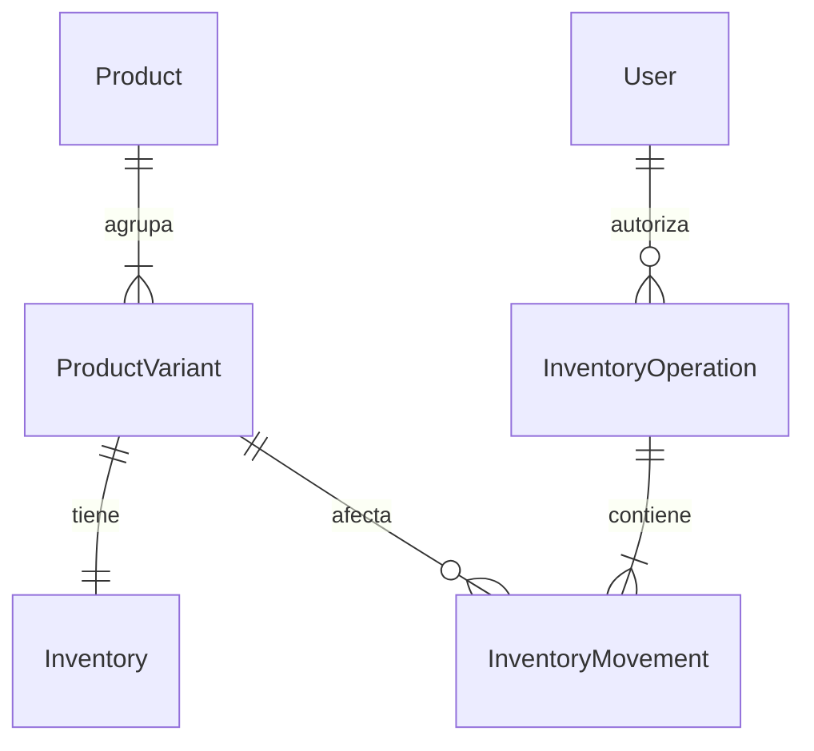

# 03. Diseño de inventario — NO IMPLEMENTADO

## Alternativas

| Alternativa | Complejidad/escalabilidad | Integridad/auditoría/concurrencia | Encaje |
| --- | --- | --- | --- |
| A: Product.stock | Baja, insuficiente modelo/talla | CHECK y update atómico posibles; sin trazabilidad; PUT puede pisar saldo | Ya existe pero sin uso; no recomendado como fuente definitiva |
| B: Inventory separado | Media, admite SKU y permisos distintos | Bloqueo por saldo y constraints; no explica cambios sin ledger | Posible, pero insuficiente para entradas/salidas/ajustes auditables |
| C: Inventory + Movement | Media; una transacción local | Saldo y movimientos atómicos, idempotencia y reconciliación | Recomendado mínimo práctico para ventas externas y varios diseños |

Elegir C dentro de Node/Prisma/PostgreSQL actuales. Sin microservicios, Redis, reservas ni checkout nuevo. Se justifica historial para administrar entradas/salidas manuales y reintentos, no por escalar prematuramente.

## Modelo conceptual (no migración)

- Product: conservar ficha/precio/galería; añadir publicationStatus DRAFT/PUBLISHED/ARCHIVED. Archivo lógico cuando exista historial.
- ProductVariant: UUID, productId FK RESTRICT, sku único estable, label/modelo, modelKey/sizeKey no nulos (default explícito), imageUrl opcional, isActive y fechas; UNIQUE(productId,modelKey,sizeKey). No depender de unicidad de campos NULL. Tarifa única de ficha inicialmente, sujeta a aprobación.
- Inventory: variantId PK/FK RESTRICT, onHand Int nullable, initializedAt nullable, version Int, updatedAt. NULL=sin contar, cero=agotado confirmado. CHECK(onHand IS NULL OR onHand>=0) y coherencia de inicialización; no duplicar available sin reservas.
- InventoryOperation: UUID, idempotencyKey único, requestHash, actorId FK RESTRICT, motivo, referencia externa opcional no personal, fecha. Reintento misma clave/body devuelve resultado original; diferente body=409.
- InventoryMovement: UUID, operationId FK, variantId FK, tipo OPENING/RECEIPT/ISSUE/ADJUSTMENT/RETURN, delta entero, before/after, fecha. CHECK(after>=0), UNIQUE(operationId,variantId), coherencia aritmética. Opening=0 permitido como conteo explícito. API append-only; compensar con movimiento nuevo, no editar historial.

Mantener Product.stock sin leerlo como segunda fuente. No sincronizar dos saldos; retirarlo solo en fase futura tras revisar writers. Un producto simple tiene SKU default. Dos diseños Gryffindor M son SKUs diferentes; dos fotos del MISMO diseño son un solo SKU. Nunca inferir variante por índice de foto. Al archivar usuarios/productos conservar FKs de movimientos.

## Escritura y concurrencia

1. Guard/CSRF existentes, DTO Zod strict, cantidades enteras acotadas y motivo; actor tomado de sesión. Revalidar actor activo en transacción coordinando su desactivación con bloqueo de fila.
2. Insertar operación con clave única. Si compite otra petición con misma clave, resolver conflicto fuera de transacción fallida, consultar resultado y comparar hash, sin repetir salida.
3. Bloquear saldos por variantId ordenado con FOR UPDATE. Comprobar inicialización/versión/saldo; salida mediante update condicional onHand>=cantidad o cálculo dentro del lock. Nunca read fuera de transacción + write absoluto sin control.
4. Actualizar saldo/version y crear movimiento before/delta/after en la MISMA transacción. Ajuste absoluto exige expectedVersion; conflicto=409 y revisión. Guardar ficha no toca stock.
5. Multi-SKU all-or-nothing. Fallo o insuficiencia en uno revierte todo. CHECK final y límites evitan negativos/overflow. Retry acotado de deadlock/conflictos transitorios con MISMA clave. Timeout desconocido se consulta/reintenta, no se genera otra salida.
6. Opening solo si onHand NULL y versión esperada; inicialización/movimiento atómicos. Reconciliar suma ledger desde opening contra saldo; corrección aprobada, no reparación silenciosa.

Transacciones cortas, sin S3/HTTP/WhatsApp dentro. Lock por fila, no advisory global de todo el inventario. El ledger no protege contra superusuario SQL: revisar permisos y acceso operacional. Referencia: [PostgreSQL: bloqueo por fila](https://www.postgresql.org/docs/current/explicit-locking.html). Primitivas transaccionales ya presentes en repositories/users.ts/auth.ts; no requiere actualizar Prisma 5 para esta propuesta.

## Visibilidad y consultas

ENFORCE: PUBLISHED y al menos una variante activa con saldo conocido >0. Agotados/pendientes ocultos público, visibles admin. Reponer no publica DRAFT/ARCHIVED. Variantes agotadas deshabilitadas, ficha visible si otra tiene saldo. Aplicar EXISTS en SQL ANTES de paginar y también a total/facetas/ofertas/relacionados. No filtrar filas después en React.

Detalle público oculto404 propuesto; admin endpoint distinto para editar/consultar sin ocultación. No usar lista pública como repositorio admin. Imágenes ya distribuidas no son secretas por ocultar ficha; política media explícita sin prometer revocación de URLs. Medir índices variante(productId,isActive)/saldo y EXPLAIN aislado; evitar N+1.

CAPTURE: pendientes visibles como hoy, disponibilidad por confirmar. ENFORCE no debe activarse con pendientes publicados sin excepción aprobada. Pendiente no significa ilimitado ni cero.

## Carrito y cotización

CartEntry v2: variantId/SKU, cantidad, foto de presentación. Agrupar cantidades por SKU aunque se eligieran distintas fotos del mismo modelo. Carrito antiguo: si no hay mapeo único exigir elegir modelo/talla; nunca asignar por posición de foto.

Validar al añadir/cambiar y justo antes de WhatsApp en endpoint de validación de cotización sin crear pedidos. Resolver solo IDs y cantidades; retornar precio/nombre/modelo/talla actuales, no confiar en importes cliente. Agregar duplicados por SKU antes de comprobar saldo. Cotizaciones simultáneas no reservan; precio y disponibilidad siguen por confirmar.

Abrir WhatsApp NO descuenta. Admin registra salida cuando confirme venta/entrega según decisión del propietario. La salida atómica consume, no la cotización; rechazar sin saldo. No se evita sobreventa externa si el negocio vende sin registrar movimientos.

Sin pasarela, fallo de pago web no aplica. Cancelación sin salida=no movimiento; si hubo salida/devolución, compensación autorizada solo tras confirmar mercancía vendible recibida. Reservas/pedidos/estados quedan fuera: si se piden exigirían expiración/liberación idempotente y diseño adicional.

## Productos existentes y migración gradual

Expandir tablas/contratos sin reinterpretar ceros. Backfill por lotes, dry-run y clave SKU estable; crear default variante e Inventory NULL. Reiniciable/idempotente, conservar IDs/fotos/precios. Modelos reales se mapean manualmente; no crear un SKU por foto. Capturar cada conteo con OPENING auditado y versión.

Reporte previo: publicados, mapeados, pendientes, ceros confirmados, elegibles y diferencias. No inventar cantidades. Feature mode conceptual backend OFF/CAPTURE/ENFORCE: OFF comportamiento previo, CAPTURE conteos sin ocultar, ENFORCE regla pública. No se crea ninguna variable en esta auditoría. Activación por selección aprobada explícita si conviene, luego global; un único conjunto compatible de writers registra salidas.

Rollback ENFORCE→CAPTURE vuelve a visibilidad anterior, pudiendo mostrar agotados: decisión comercial explícita. Mantener saldos/movimientos/tablas; al volver a código antiguo bloquear escrituras incompatibles y reconciliar ventas durante pausa. No DROP/reset/seed ni backup sobre ventas nuevas. Retirada de Product.stock en release independiente y posterior.
